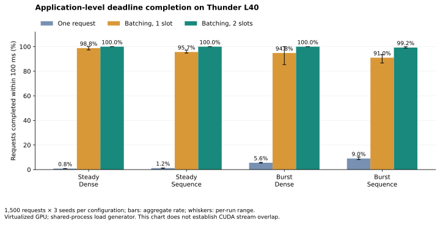
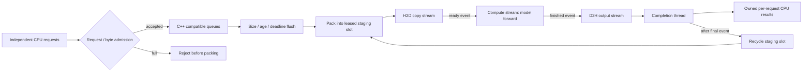
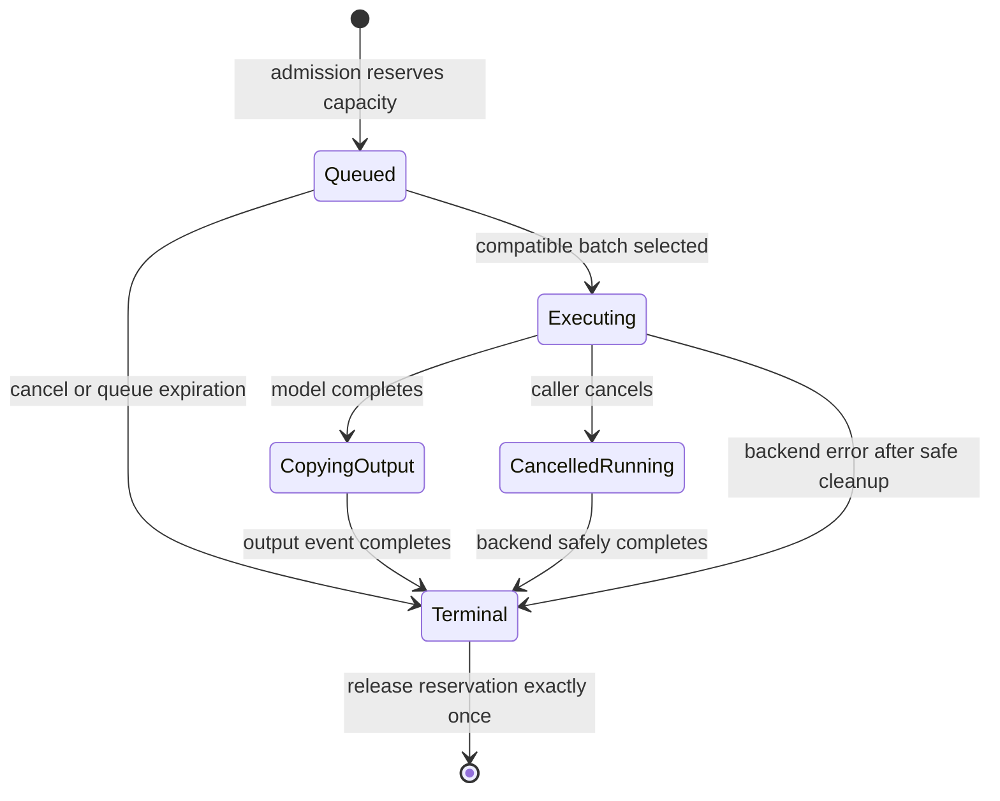
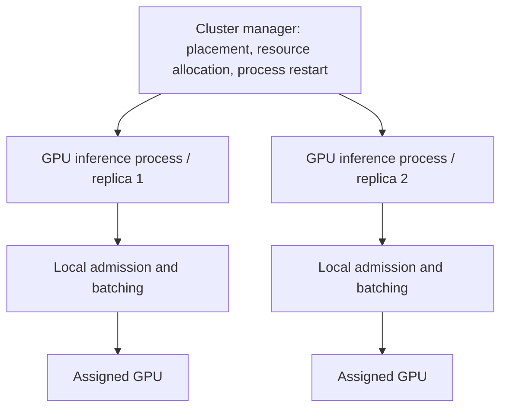

# GPU Inference Runtime

**Bounded dynamic batching and event-driven execution for GPU inference.**


## Measured behavior at a glance

Independent requests enter a bounded queue, compatible requests share a GPU batch, and each caller receives its own result.



**Initial measurement on one Thunder L40:** 25 correctness tests passed; two-slot batching completed all 4,500 steady-traffic requests for each bundled model within the 100 ms deadline. The chart uses 1,500 requests × three seeds at a nominal 1,000 requests/s. These application-level results include host/framework overhead. [Full results and measurement boundaries](#gpu-application-level-results).


An inference service receives independent requests, while a GPU benefits from larger batches. Waiting to fill a batch adds latency; padding unrelated sequence lengths wastes work; accepting every request can exhaust staging memory before the GPU catches up. This project makes those decisions explicit in a small, independently runnable execution subsystem.

A C++20 scheduler handles admission, compatible request grouping and queue deadlines. A PyTorch backend packs tensors, runs a model and restores each request's output. The CUDA path uses reusable pinned/device buffers and event dependencies between transfer and compute streams.



## Implemented optimizations

| Mechanism | What it changes | Why this choice matters |
|---|---|---|
| Early bounded admission | Reserves request count and estimated staging/output bytes before packing | Limits accepted work during bursts; excess work fails immediately instead of expanding queues indefinitely |
| Compatible dynamic batching | Groups by immutable model version and input shape bucket | Amortizes model execution while keeping incompatible tensors and generations separate |
| Deadline-aware flush | Flushes on batch size, maximum wait, or earliest deadline minus an observed service-time estimate | Trades batch size for remaining latency budget; predictions are a heuristic and do not guarantee deadlines |
| Sequence shape buckets | Rounds sequence lengths into power-of-two buckets | Reduces padding compared with padding every sequence to the configured maximum; more buckets can fragment batches |
| Reusable staging slots | Reuses capped host/device buffers across batches | Avoids per-request staging allocations; full-batch capacity consumes space even for a small batch |
| CUDA event pipeline | Separates H2D, compute and D2H streams with explicit dependencies | Allows another batch to make progress while an earlier batch executes; actual overlap depends on hardware and workload |
| Native metadata scan | Builds all group readiness estimates in one queue scan | Avoids rescanning the queue separately for each compatibility group |

## Quick start

Requirements: Python 3.11+, a C++20 compiler and a working PyTorch installation. CUDA execution additionally requires an NVIDIA GPU, compatible driver and CUDA-enabled PyTorch. CPU execution exercises the same scheduler and request lifecycle.

```bash
python -m venv .venv
source .venv/bin/activate
python -m pip install -U pip
python -m pip install '.[test]'
python -m pytest -q
```

Use PyTorch's [installation selector](https://pytorch.org/get-started/locally/) when choosing a GPU wheel for your driver.

```python
import torch
from gpu_runtime import Runtime, ModelSpec
from gpu_runtime.models import DenseModel

model = DenseModel(features=256, hidden=512, outputs=32)
with Runtime(device="cpu", max_batch=64, delay_ms=2) as runtime:
    runtime.register("dense-v1", ModelSpec(model, "dense", 256, 32))
    handles = [runtime.submit("dense-v1", torch.randn(1, 256), timeout_ms=1000)
               for _ in range(16)]
    results = [handle.result(timeout=3) for handle in handles]
    print(results[0].shape)  # [1, 32]
```

Change `device="cpu"` to `device="cuda"` to use the CUDA backend. Keep submitted CPU tensors and registered models unchanged until their requests finish. Results are independent CPU tensors; later staging-slot reuse does not overwrite them.

A request can contain multiple samples. `max_batch` limits total samples in one execution, rather than the number of request objects. `Handle.result(timeout)` limits the caller's wait; `submit(timeout_ms=...)` supplies the execution deadline. Cancelling a handle detaches the caller, while already launched work retains its buffers until completion.

## Distributed request routing

A bounded CPU router can send complete inference requests to matching model replicas on separate GPU hosts. Each worker retains its own batching queue and buffer ownership. Model fingerprints are checked before routing, and a failed connection can be retried on another replica while deadline budget remains. [Architecture, failure semantics and examples](docs/DISTRIBUTED.md).

The initial figure above is the completed single-GPU measurement. Larger single-worker sweeps and the two-host experiment are being evaluated separately; their results will be reported with the transport and concurrency conditions.

## Two model adapters

| Adapter | Inputs | Output | Validation workload |
|---|---|---|---|
| Dense | `float32[B, features]` | `float32[B, outputs]` | Three-layer MLP |
| Sequence | `int64[B, L]` tokens and `int64[B]` lengths | `float32[B, outputs]` | Embedding, masked attention pooling and MLP |

For sequence requests, lengths must be positive and within the supplied tensor width. Tokens must be within the registered vocabulary. Each compatibility group uses one padded length bucket, then output offsets restore each request's sample range.

```text
Request A: 2 sequences, length 5  ─┐
Request B: 1 sequence,  length 7  ─┴─ bucket 8 → model forward [3, 8]
                                                   ↓
                                output rows [0:2] → A; [2:3] → B
Request C: 1 sequence, length 31 ─── bucket 32 → separate execution
```

The bundled models have random weights and exercise actual model forward operations. They validate runtime behavior rather than model accuracy. The current adapters support single-device, stateless forward inference. Autoregressive LLM token scheduling, KV-cache paging, training and distributed model parallelism are separate execution contracts.

## Ownership and failure behavior



A batch holds references to its model generation, input records and staging slot until completion. A running cancellation does not interrupt a CUDA kernel. Queued deadlines remove stale work; a deadline exceeded during execution returns `TimeoutError` after the backend reaches a safe completion point.

The scheduler accounts for request reservations, while the staging pool separately enforces its own allocation budget. These budgets exclude model weights, intermediate activations, CUDA context memory, allocator caches and caller-retained result tensors. They should not be interpreted as a bound on total process or GPU memory.

A normal model exception fails the affected batch and returns its permits. A CUDA context failure closes admission and quarantines uncertain buffers; the process should be restarted. Normal shutdown closes admission, flushes accepted queued work and waits for completion. Process or machine crashes lose in-memory requests, so clients need bounded retry and application-specific idempotency rules.

## Running under a cluster manager

The runtime can live inside a process managed by Borg or Kubernetes. The cluster manager places and restarts that process; request scheduling remains inside it. Google Borg itself is internal, so this repository includes a public Kubernetes deployment example and a local process-lifecycle test.



The demonstration HTTP service exposes:

- `GET /healthz`: dispatcher and completion thread liveness.
- `GET /readyz`: model registration and admission readiness.
- `GET /metrics`: scheduler, completion and staging counters.
- `POST /infer`: JSON `{"x": [[...256 floats...]], "timeout_ms": 1000}`.
- `SIGTERM`: stop admission and drain accepted work before exit.

```bash
gpu-runtime-service --device cpu --host 127.0.0.1 --port 8080
# In another terminal:
curl http://127.0.0.1:8080/readyz
```

HTTP handling is capped at 32 concurrent connections with a 1 MiB body limit. The example is an internal integration surface; put authentication, TLS, discovery and external load balancing in the deployment layer.

```bash
docker build -t gpu-inference-runtime:local .
# Requires NVIDIA container support:
docker run --rm --gpus 1 -p 127.0.0.1:8080:8080 gpu-inference-runtime:local
# Set an image accessible to the cluster before applying:
kubectl apply -f deploy/kubernetes.yaml
```

The deployment requests one GPU using `nvidia.com/gpu`, requires the NVIDIA device plugin, and gives the process 30 seconds to drain. Container and Kubernetes deployment validation are listed separately from local process tests in [validation status](#validation-status).

## Evaluation

The benchmark sends requests at planned open-loop arrival times, using the same seeded inputs for each configuration. It records goodput before the deadline, P50/P95/P99 completion latency, admission rejection, expiration, batch size, padding, staging allocation, stage durations and load-generator lag.

```bash
python benchmarks/run.py --device cpu --requests 300 --rps 500 \
    --deadline-ms 100 --output results/cpu-smoke.json
python benchmarks/run.py --device cuda --requests 5000 --rps 2000 \
    --deadline-ms 50 --output results/gpu-steady.json
python benchmarks/run.py --device cuda --requests 5000 --rps 2000 \
    --deadline-ms 50 --burst --output results/gpu-burst.json
```

The configurations isolate execution choices:

| Mode | Maximum batch | In-flight CUDA slots | Flush |
|---|---:|---:|---|
| `unbatched` | 1 sample | 1 | Immediate |
| `sync` | 64 samples | 1 | Size / age / deadline |
| `pipeline` | 64 samples | 2 | Size / age / deadline |

On CPU, `sync` and `pipeline` both execute one batch at a time. CPU runs cannot demonstrate transfer/compute overlap. `--policy age` disables the deadline-based early flush; `--no-buckets` pads sequences to the registered maximum for an ablation. `--samples` selects samples per request (the unbatched baseline still executes one request at a time); `--features`, `--hidden`, and `--embedding` scale model work. `--burst` compresses each 200 ms arrival interval into its first 20 ms.

The CUDA timeline records events against a shared origin. `measured_cross_batch_h2d_compute_overlap_ms` sums intersections between one batch's H2D interval and another batch's compute interval. On a platform with supported event/profiler semantics, a positive value provides event-level evidence of overlap; a speedup still requires throughput and latency comparisons. See [GPU evaluation procedure](docs/GPU_EVALUATION.md) for the prepared test matrix and trace instructions.

### GPU application-level results

The GPU run used one Thunder Compute **NVIDIA L40 (48 GB class)** instance, six vCPUs, Python 3.12.13, PyTorch 2.12.1+cu130 and one PyTorch CPU thread. Both dense and sequence outputs passed the direct-model comparisons; all **25 tests passed**, including the CUDA tests. [Raw results and SHA-256 checks](results/gpu/) accompany the run.

Each steady/burst configuration used 1,500 requests, three seeds (7, 17, 27), a nominal 1,000 requests/s arrival process and a 100 ms deadline. The table aggregates on-time counts; latency, goodput and generator lag are medians of the three per-run summaries. These are application-level results on a virtualized GPU, including host scheduling and framework overhead.

| Traffic / model | Mode | On-time / 4,500 | Goodput (req/s) | P99 (ms) | Generator lag P99 (ms) |
|---|---|---:|---:|---:|---:|
| steady / dense | unbatched | 37 | 7.7 | 108.56 | 6.21 |
| steady / dense | sync | 4,446 | 997.6 | 99.29 | 74.46 |
| steady / dense | pipeline | 4,500 | 1022.1 | 27.87 | 6.03 |
| steady / sequence | unbatched | 54 | 11.6 | 106.86 | 2.79 |
| steady / sequence | sync | 4,305 | 958.4 | 127.22 | 81.32 |
| steady / sequence | pipeline | 4,500 | 992.5 | 82.18 | 6.77 |
| burst / dense | unbatched | 251 | 54.5 | 106.88 | 6.03 |
| burst / dense | sync | 4,268 | 1034.0 | 99.68 | 71.54 |
| burst / dense | pipeline | 4,500 | 1049.9 | 41.39 | 6.70 |
| burst / sequence | unbatched | 406 | 86.0 | 105.81 | 8.45 |
| burst / sequence | sync | 4,096 | 955.4 | 103.62 | 72.88 |
| burst / sequence | pipeline | 4,466 | 1012.0 | 99.98 | 26.73 |

Batching substantially increased the number of requests meeting this deadline compared with executing one request at a time. Two in-flight slots completed all 4,500 steady-traffic requests for each model; burst sequence traffic completed 4,466 / 4,500. The shared-process generator stalled more in several one-slot runs, so these comparisons include host-side scheduling effects and do not isolate a CUDA-overlap benefit.

**Workload-dependent outcomes:** the single-run sequence ablation reduced padded token positions from 384,000 to 125,728 with buckets, while observed P99 increased from 33.47 to 79.36 ms. Reducing padding did not guarantee a latency improvement in this workload. In the larger dense exploratory run (4 samples/request, 4,096 features, hidden width 2,048, nominal 2,000 requests/s), two slots produced 431.5 deadline-goodput requests/s versus 525.3 with one slot; its generator lag P99 reached 123.25 ms. That run cannot establish the runtime's maximum sustainable throughput.

**Profiling boundary:** Thunder [documents GPU virtualization](https://www.thundercompute.com/docs/legacy/prototyping-and-production-modes) and lists [GPU profilers as incompatible](https://www.thundercompute.com/docs/compatibility). The exported trace contains generic kernel names, stream ID 0 and zero-byte copy metadata. The event-based overlap counter reported 0 ms. This run does **not** establish physical transfer/compute overlap; validate that separately on a standard CUDA environment. The repository retains the trace as a diagnostic artifact.

<details>
<summary>Local CPU smoke results</summary>


The checked-in [raw CPU smoke run](results/cpu-smoke.json) records 300 requests per model/mode, a nominal 500 requests/s arrival process, a 100 ms deadline and one PyTorch CPU thread. This is a functional and instrumentation check; it does not measure maximum sustainable throughput or GPU performance. Arrival randomness and generator scheduling affect this short run.

| Model | Mode | Successful / offered | P50 (ms) | P99 (ms) |
|---|---|---:|---:|---:|
| dense | unbatched | 300 / 300 | 0.70 | 2.49 |
| dense | sync | 300 / 300 | 2.92 | 5.75 |
| dense | pipeline | 300 / 300 | 3.14 | 34.79 |
| sequence | unbatched | 300 / 300 | 0.76 | 3.15 |
| sequence | sync | 300 / 300 | 2.98 | 4.86 |
| sequence | pipeline | 300 / 300 | 2.97 | 4.93 |

The deterministic padding test uses four length-5 sequences and a configured maximum length of 128. Without buckets it prepares 512 token positions; bucket 8 prepares 32, with the same 20 useful tokens and matching outputs.

</details>

### Validation status

| Check | Status |
|---|---|
| CPU scheduler/runtime/service tests | 22 passed locally; Linux Python 3.11 and 3.12 [CI passed](https://github.com/Zhang-Xin-Duke/gpu-inference-runtime/actions/runs/40509579725) |
| CUDA scheduler/runtime tests | 25 total tests passed on Thunder L40; no CUDA skips |
| Wheel build and normal installation | Passed locally |
| Open-loop GPU benchmark | Steady/burst runs across 3 seeds, policy/padding ablations and larger-model exploratory run completed |
| Physical CUDA stream overlap | Unestablished; provider profiler limitations documented above |
| Container image / GPU Kubernetes deployment | Example supplied; deployment unverified |
| Google Borg deployment | Requires internal access; unverified |

To regenerate the result summary and chart from saved runs:

```bash
python -m pip install matplotlib
python benchmarks/summarize.py --root results/gpu --plot docs/gpu-deadline-completion.svg
```

## Repository map

| Path | Responsibility |
|---|---|
| `cpp/scheduler.cpp` | Admission, compatibility grouping, batching, deadlines and reservation lifecycle |
| `src/gpu_runtime/runtime.py` | Tensor validation, packing, model versions, staging slots, stream/event ownership and completion |
| `src/gpu_runtime/models.py` | Dense and sequence validation models |
| `src/gpu_runtime/service.py` | Bounded HTTP adapter and graceful process termination |
| `tests/` | Scheduler, runtime correctness, cancellation, failures and process lifecycle |
| `benchmarks/run.py` | Seeded open-loop benchmark and raw JSON output |
| `deploy/kubernetes.yaml` | Example cluster deployment contract |
| `docs/DESIGN.md` | Detailed lifecycle and design choices |

## References

1. A. Verma et al., “Large-scale cluster management at Google with Borg,” *EuroSys*, 2015. [Google Research](https://research.google/pubs/large-scale-cluster-management-at-google-with-borg/). Cluster-level application placement and lifecycle responsibilities.
2. PyTorch, “CUDA semantics.” [Official documentation](https://docs.pytorch.org/docs/stable/notes/cuda.html). Stream dependencies and memory lifetime.
3. PyTorch, “CUDA Event.” [Official API documentation](https://docs.pytorch.org/docs/stable/generated/torch.cuda.Event.html). Completion polling and elapsed-time measurement.
4. Kubernetes, “Schedule GPUs.” [Official documentation](https://kubernetes.io/docs/tasks/manage-gpus/scheduling-gpus/). GPU resources and device plugins.
5. Kubernetes, “Pod Lifecycle.” [Official documentation](https://kubernetes.io/docs/concepts/workloads/pods/pod-lifecycle/). Termination behavior and grace periods.

## License

Copyright © 2026 Xin Zhang. Available under the [PolyForm Noncommercial License 1.0.0](LICENSE). Commercial use requires separate permission.
