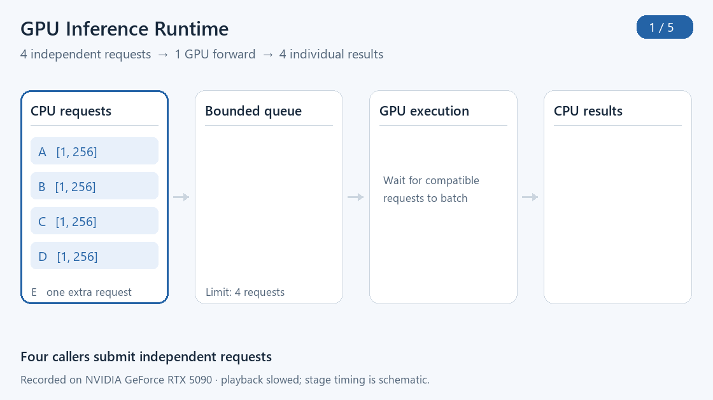
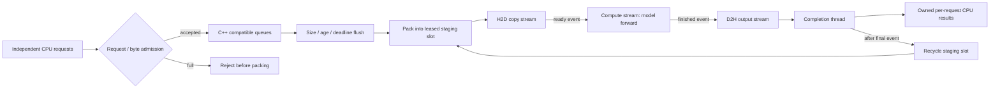
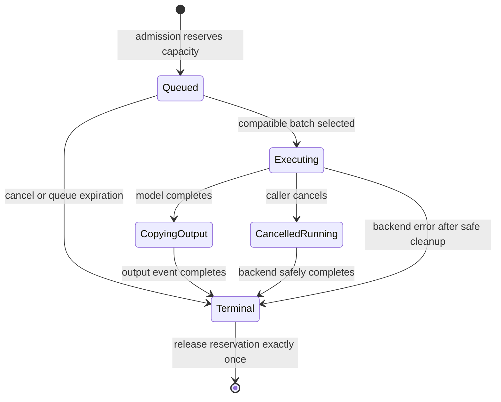
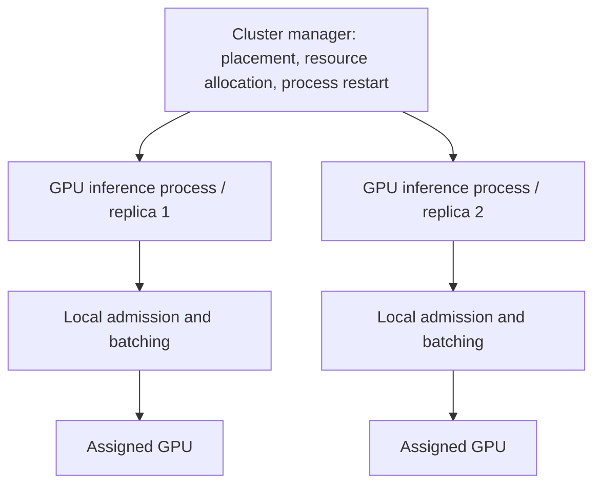

# GPU Inference Runtime

GPU Inference Runtime is a **C++20/PyTorch execution layer for stateless GPU inference**. It batches compatible requests, enforces admission and deadline policies, and routes independent requests across model replicas. Each caller receives an owned CPU tensor when its request completes.

[Quick start](#quick-start) · [Architecture](#architecture) · [L40 evaluation](#l40-evaluation) · [Distributed routing](docs/DISTRIBUTED.md)

## Demonstration

https://github.com/user-attachments/assets/2ab5fb82-63d8-4ec7-8c25-6c92ca5e4261

**Recorded terminal walkthrough on an RTX 5090:** batching, overload rejection, sequence buckets, HTTP inference and a short load test. [Download the MP4](docs/demo/terminal-walkthrough.mp4) · [Recording and replay instructions](docs/demo/README.md).



**Example request flow:** four `[1, 256]` inputs form one `[4, 256]` GPU batch and return four `[1, 32]` CPU results. A fifth request exceeds the four-request admission limit and is rejected.

1. **Admit:** reserve request and byte capacity before packing tensors.
2. **Batch:** group compatible model versions and shapes; flush on size, age or deadline.
3. **Complete:** copy results back, restore each caller's rows, then recycle staging buffers.

The animation illustrates [recorded request data](docs/demo/recording.json), slowed into explanatory stages. Its timing is schematic. Outputs passed comparison with a direct model forward.

After [installation](#quick-start), run the same example:

```bash
python examples/quick_demo.py --device cuda
# cuda: 4 requests -> [[4, 256]] model forward -> 4 CPU results; fifth rejected; parity passed
```

Use `--device cpu` to explore the same request lifecycle without a GPU. [Example source](examples/quick_demo.py) · [Architecture](docs/DESIGN.md) · [Quick start](#quick-start).

## L40 evaluation


A **1.08B-parameter float32 MLP** runs on one or two L40 devices, with the generator and CPU router on the same host over local HTTP. Both configurations receive identical inputs at nominal 1,000 requests/s with a 1,000 ms deadline. Throughput and P99 are medians of two 10-second runs with different seeds; request counts aggregate both runs.

| Measurement | One GPU | Two GPUs |
|---|---:|---:|
| Deadline goodput | 244.10 req/s | 519.85 req/s |
| Admitted-request P99 | 1,005.51 ms | 542.58 ms |
| On-time requests / offered, both seeds | 4,882 / 20,244 | 10,397 / 20,244 |

Two replicas deliver **2.13× deadline goodput** in this overloaded workload. Rejected, expired and failed requests remain in the [full results](docs/MULTI_GPU_EVALUATION.md).


In the same deployment, a three-replica stop/restart test spans two hosts. Healthy peers complete **2,335 requests** while one worker is stopped; that worker is observed completing requests again about **23.2 seconds** after restart. The 75-second run records **6,818 / 7,485** on-time requests and **667 failures**. Connections peak at **35** and return to zero after drain.

[Conditions, failure analysis and reproduction](docs/MULTI_GPU_EVALUATION.md) · [Raw data and checksums](results/three-l40-2026-10-28/)

## Architecture

The runtime balances batch size, queueing delay and staging memory. Compatible requests share a GPU execution batch; admission limits bound accepted work, and flush policies decide when a partial batch executes. Sequence-length buckets control padding overhead.

A C++20 scheduler handles admission, compatible request grouping and queue deadlines. A PyTorch backend packs tensors, runs a model and restores each request's output. The CUDA path uses reusable pinned/device buffers and event dependencies between transfer and compute streams.



## Design choices

| Mechanism | Implementation | Purpose and trade-off |
|---|---|---|
| Early bounded admission | Reserves request count and estimated staging/output bytes before packing | Limits accepted work during bursts; excess work fails immediately instead of expanding queues indefinitely |
| Compatible dynamic batching | Groups by immutable model version and input shape bucket | Amortizes model execution while keeping incompatible tensors and generations separate |
| Deadline-aware flush | Flushes on batch size, maximum wait, or earliest deadline minus an observed service-time estimate | Trades batch size for remaining latency budget; predictions are a heuristic and do not guarantee deadlines |
| Sequence shape buckets | Rounds sequence lengths into power-of-two buckets | Reduces padding compared with padding every sequence to the configured maximum; more buckets can fragment batches |
| Reusable staging slots | Reuses capped host/device buffers across batches | Avoids per-request staging allocations; full-batch capacity consumes space even for a small batch |
| CUDA event pipeline | Separates H2D, compute and D2H streams with explicit dependencies | Allows another batch to make progress while an earlier batch executes; actual overlap depends on hardware and workload |
| Native metadata scan | Builds all group readiness estimates in one queue scan | Avoids rescanning the queue separately for each compatibility group |

## Quick start

Requirements: Python 3.11+, a C++20 compiler and a working PyTorch installation. CUDA execution additionally requires an NVIDIA GPU, compatible driver and CUDA-enabled PyTorch. CPU execution exercises the same scheduler and request lifecycle.

```bash
python -m venv .venv
source .venv/bin/activate
python -m pip install -U pip
python -m pip install '.[test]'
python -m pytest -q
```

Use PyTorch's [installation selector](https://pytorch.org/get-started/locally/) when choosing a GPU wheel for your driver.

```python
import torch
from gpu_runtime import Runtime, ModelSpec
from gpu_runtime.models import DenseModel

model = DenseModel(features=256, hidden=512, outputs=32)
with Runtime(device="cpu", max_batch=64, delay_ms=2) as runtime:
    runtime.register("dense-v1", ModelSpec(model, "dense", 256, 32))
    handles = [runtime.submit("dense-v1", torch.randn(1, 256), timeout_ms=1000)
               for _ in range(16)]
    results = [handle.result(timeout=3) for handle in handles]
    print(results[0].shape)  # [1, 32]
```

Change `device="cpu"` to `device="cuda"` to use the CUDA backend. Keep submitted CPU tensors and registered models unchanged until their requests finish. Results are independent CPU tensors; later staging-slot reuse does not overwrite them.

A request can contain multiple samples. `max_batch` limits total samples in one execution, rather than the number of request objects. `Handle.result(timeout)` limits the caller's wait; `submit(timeout_ms=...)` supplies the execution deadline. Cancelling a handle detaches the caller, while already launched work retains its buffers until completion.

## Distributed request routing

A bounded CPU router sends independent requests to GPU workers with matching model fingerprints. Each worker owns a complete model replica, a local batching queue and its staging buffers. The router leases connections from a bounded per-replica pool and can retry a transport failure on another worker within the remaining deadline. [Routing, failure semantics and examples](docs/DISTRIBUTED.md).

## Model interfaces

| Adapter | Inputs | Output | Validation workload |
|---|---|---|---|
| Dense | `float32[B, features]` | `float32[B, outputs]` | Three-layer MLP |
| Sequence | `int64[B, L]` tokens and `int64[B]` lengths | `float32[B, outputs]` | Embedding, masked attention pooling and MLP |

For sequence requests, lengths must be positive and within the supplied tensor width. Tokens must be within the registered vocabulary. Each compatibility group uses one padded length bucket, then output offsets restore each request's sample range.

```text
Request A: 2 sequences, length 5  ─┐
Request B: 1 sequence,  length 7  ─┴─ bucket 8 → model forward [3, 8]
                                                   ↓
                                output rows [0:2] → A; [2:3] → B
Request C: 1 sequence, length 31 ─── bucket 32 → separate execution
```

The bundled models have random weights and exercise actual model forward operations. They validate runtime behavior rather than model accuracy. The current adapters support single-device, stateless forward inference. Autoregressive LLM token scheduling, KV-cache paging, training and distributed model parallelism are separate execution contracts.

## Ownership and failure behavior



A batch holds references to its model generation, input records and staging slot until completion. A running cancellation does not interrupt a CUDA kernel. Queued deadlines remove stale work; a deadline exceeded during execution returns `TimeoutError` after the backend reaches a safe completion point.

The scheduler accounts for request reservations, while the staging pool separately enforces its own allocation budget. These budgets exclude model weights, intermediate activations, CUDA context memory, allocator caches and caller-retained result tensors. They should not be interpreted as a bound on total process or GPU memory.

A normal model exception fails the affected batch and returns its permits. A CUDA context failure closes admission and quarantines uncertain buffers; the process should be restarted. Normal shutdown closes admission, flushes accepted queued work and waits for completion. Process or machine crashes lose in-memory requests, so clients need bounded retry and application-specific idempotency rules.

## Deployment

The runtime operates inside a GPU worker process. A cluster manager places and restarts the process; admission and request scheduling remain inside the worker. The repository includes a Dockerfile, a Kubernetes deployment example and a local process-lifecycle test.



The demonstration HTTP service exposes:

- `GET /healthz`: dispatcher and completion thread liveness.
- `GET /readyz`: model registration and admission readiness.
- `GET /metrics`: scheduler, completion and staging counters.
- `POST /infer`: JSON `{"x": [[...256 floats...]], "timeout_ms": 1000}`.
- `SIGTERM`: stop admission and drain accepted work before exit.

```bash
gpu-runtime-service --device cpu --host 127.0.0.1 --port 8080
# In another terminal:
curl http://127.0.0.1:8080/readyz
```

HTTP handling is capped at 32 concurrent connections with a 1 MiB body limit. The example is an internal integration surface; put authentication, TLS, discovery and external load balancing in the deployment layer.

```bash
docker build -t gpu-inference-runtime:local .
# Requires NVIDIA container support:
docker run --rm --gpus 1 -p 127.0.0.1:8080:8080 gpu-inference-runtime:local
# Set an image accessible to the cluster before applying:
kubectl apply -f deploy/kubernetes.yaml
```

The deployment requests one GPU using `nvidia.com/gpu`, requires the NVIDIA device plugin, and gives the process 30 seconds to drain. [Validation status](#reproduce-and-validate) records the deployment coverage.

## Reproduce and validate

Start identical services on the dual-GPU host, one per device:

```bash
CUDA_VISIBLE_DEVICES=0 gpu-runtime-service --device cuda --hidden 32768 --max-batch 128 --port 8090
CUDA_VISIBLE_DEVICES=1 gpu-runtime-service --device cuda --hidden 32768 --max-batch 128 --port 8091
```

From another terminal on that host:

```bash
python benchmarks/compute_replicas.py \
    --endpoints http://127.0.0.1:8090 http://127.0.0.1:8091 \
    --rates 1000 --duration 10 --output-dir results/compute/sweep
python benchmarks/summarize_replicas.py --root results/compute
```

Both GPU hosts passed **33 tests**, including the CUDA cases. Tests cover scheduling, admission, output parity, deadlines, cancellation, connection bounds, restart invalidation and shutdown. CPU-only execution skips CUDA tests. Container and Kubernetes deployment remain unverified.

[Benchmark procedure](docs/GPU_EVALUATION.md) · [Recorded L40 experiment](docs/MULTI_GPU_EVALUATION.md) · [Earlier evaluations](docs/HISTORICAL_EVALUATION.md)

## Repository map

| Path | Responsibility |
|---|---|
| `cpp/scheduler.cpp` | Admission, compatibility grouping, batching, deadlines and reservation lifecycle |
| `src/gpu_runtime/runtime.py` | Tensor validation, packing, model versions, staging slots, stream/event ownership and completion |
| `src/gpu_runtime/models.py` | Dense and sequence validation models |
| `src/gpu_runtime/service.py` | Bounded HTTP adapter and graceful process termination |
| `tests/` | Scheduler, runtime correctness, cancellation, failures and process lifecycle |
| `benchmarks/run.py` | Seeded open-loop benchmark and raw JSON output |
| `deploy/kubernetes.yaml` | Example cluster deployment contract |
| `docs/DESIGN.md` | Detailed lifecycle and design choices |

## References

1. A. Verma et al., “Large-scale cluster management at Google with Borg,” *EuroSys*, 2015. [Google Research](https://research.google/pubs/large-scale-cluster-management-at-google-with-borg/). Cluster-level application placement and lifecycle responsibilities.
2. PyTorch, “CUDA semantics.” [Official documentation](https://docs.pytorch.org/docs/stable/notes/cuda.html). Stream dependencies and memory lifetime.
3. PyTorch, “CUDA Event.” [Official API documentation](https://docs.pytorch.org/docs/stable/generated/torch.cuda.Event.html). Completion polling and elapsed-time measurement.
4. Kubernetes, “Schedule GPUs.” [Official documentation](https://kubernetes.io/docs/tasks/manage-gpus/scheduling-gpus/). GPU resources and device plugins.
5. Kubernetes, “Pod Lifecycle.” [Official documentation](https://kubernetes.io/docs/concepts/workloads/pods/pod-lifecycle/). Termination behavior and grace periods.

## License

Copyright © 2026 Xin Zhang. Available under the [PolyForm Noncommercial License 1.0.0](LICENSE). Commercial use requires separate permission.
