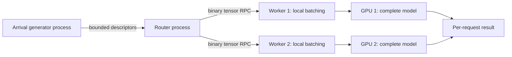

# Request-parallel distributed inference

Each worker owns a complete immutable model generation and its own C++ scheduler, staging pool and GPU. A CPU router assigns independent requests to replicas with identical model fingerprints. This is request-level data parallel inference.



## Model and transport contract

Workers expose `/metadata`, including the model version, tensor contract and a SHA-256 fingerprint of the weights. The router checks equality before accepting work. `/hardware` reports worker device information separately, so identical model replicas need not use identical GPUs.

`/infer-binary` accepts a four-byte network-order metadata length, bounded JSON tensor descriptions, and contiguous little-endian float32 or int64 payloads. Every tensor's dtype, shape and byte length is checked. The entire body is capped at 4 MiB; the header is capped at 4 KiB. The dense JSON example endpoint remains available.

For the cloud experiment, workers bind to loopback. SSH forwards carry HTTP requests; no public inference listener is exposed. The endpoints are explicitly configured. Authentication, service discovery and rolling model updates belong to the deployment integration.

## Routing and bounds

The least-work policy selects the available replica with the fewest outstanding samples. Ties rotate between replicas. Round-robin is available as a comparison. Outstanding work is reserved atomically with node selection.

The router caps pending requests and uses at most 32 RPC threads, with a limit of 16 active RPCs per replica. A queued cancellation remains accounted for until its queued wrapper is consumed. A cancellation after dispatch detaches the caller; it does not reclaim resources still used by the worker.

The router uses persistent HTTP connections and binary tensor payloads to avoid repeatedly encoding arrays as JSON. Small RPC responses disable server-side Nagle buffering. Those choices reduce avoidable transport overhead, while real network latency and CPU serialization still remain in end-to-end results.

## Deadline and failure behavior

The router maintains its own monotonic deadline and passes the remaining budget to a worker. The worker applies a relative local timeout; the router checks its original deadline again before returning a result. No cross-machine monotonic clock synchronization is assumed.

A transport failure triggers a temporary node cooldown. If time remains, one attempt may be made on a different replica. A remote operation can continue after its caller times out; failover can therefore perform duplicate computation. This is safe for the bundled stateless forward models, but it is not an exactly-once protocol for stateful operations.

Cooldown expires automatically so a restarted replica can receive requests again. The router does not persist requests, model registrations or completed results across its own process restart.

## Example

Start the same model service on each GPU host:

```bash
gpu-runtime-service --device cuda --host 127.0.0.1 --port 8080
```

After establishing the two SSH forwards:

```python
import torch
from gpu_runtime.distributed import Router

with Router(["http://127.0.0.1:19080", "http://127.0.0.1:19081"]) as router:
    futures = [router.submit(torch.randn(1, 256), timeout_ms=1000)
               for _ in range(32)]
    results = [future.result(timeout=2) for future in futures]
    print(router.stats())
```

## Extended measurement

`benchmarks/extended.py` generates timed arrivals in a separate process from inference execution. A bounded descriptor queue links the processes; the backend has a seeded input catalog, avoiding per-request tensor generation during timing. Client scheduling lag, descriptor transport delay, runtime admission time, terminal latency, rejection and expiration are recorded separately.

Histograms use fixed memory and quantiles rounded up to logarithmic bin boundaries with approximately 1% relative resolution above 1 microsecond. Results include periodic RSS, allocator observations, backend counters and exact terminal accounting. The offered cohort's on-time completions divided by the configured arrival window define goodput; drain duration is reported separately.

```bash
python benchmarks/extended.py --device cuda --duration 30 --rps 2000 \
    --kind dense --output results/extended-example.json
python benchmarks/extended.py --endpoints http://127.0.0.1:19080 http://127.0.0.1:19081 \
    --duration 30 --rps 600 --deadline-ms 1000 --output results/distributed-example.json
```

`scripts/extended_matrix.py` runs offered-load, batch-size, slot-count, model/sequence-shape and soak sweeps. `benchmarks/failover.py` records a controlled replica stop/restart using trusted operator command files kept outside the published results. Its telemetry can drive a recorded animation in the README.

Comparisons must state client concurrency, per-replica RPC limits, network transport, offered load, deadline and generator lag. Adding a replica also adds its host CPU capacity. A two-worker throughput increase should not be described as pure GPU kernel scaling without further controls.
