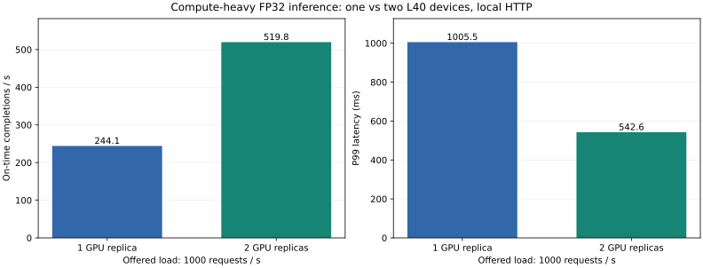
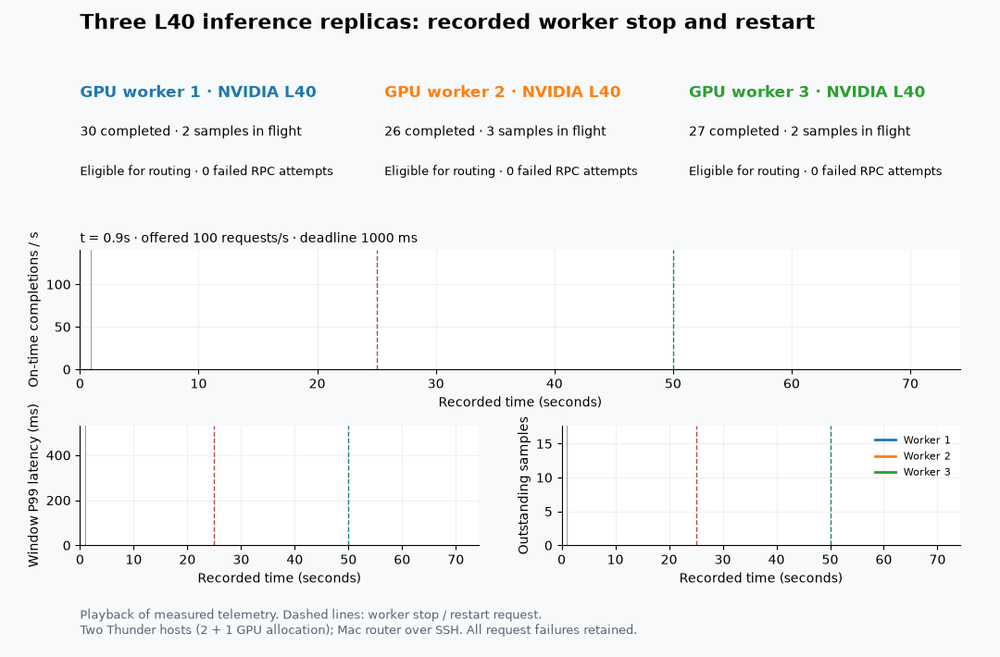

# Multi-GPU compute and recovery evaluation

On October 28, 2026, a compute-heavy workload increased deadline goodput from
**244.1 to 519.85 requests/s** when moving from one to two L40 devices. A separate
three-replica experiment verified progress on healthy workers during a worker
stop and observed the restarted worker completing requests again.

## Compute comparison: hold the transport and host constant



Both configurations used the same dual-GPU Thunder host and a local CPU router
over loopback binary HTTP. The generator ran in a separate process on that host.
This removes the Mac-to-cloud SSH path from the compute comparison.

| Measurement | One GPU replica | Two GPU replicas |
|---|---:|---:|
| Offered requests across both seeds | 20,244 | 20,244 |
| Requests completed within 1,000 ms | 4,882 | 10,397 |
| Median deadline goodput | 244.10 req/s | 519.85 req/s |
| Median completion P99 | 1,005.51 ms | 542.58 ms |
| Admission rejections | 10,811 | 9,847 |
| Expired requests | 208 | 0 |
| Failed requests | 4,342 | 0 |
| Late completions | 1 | 0 |

The goodput ratio is **2.13x** for this overloaded workload. Goodput counts only
on-time completions and divides by the arrival window; it includes the effect of
deadlines and rejection. It is not a kernel-speedup ratio. P99 covers admitted
terminal completions, including errors and expiration; immediate admission
rejections are counted separately. The two seed-level goodputs were
236.1 / 252.1 req/s for one replica and 521.3 / 518.4 req/s for two.

Conditions:

- Model: `DenseModel(256, 32768, 32)`, **1,083,244,576 parameters**, float32 weights
  and inputs, no autocast. These are random-weight validation models.
- Input: 32 samples per request; maximum execution batch 128 samples; two staging
  slots; 2 ms batching delay. Each replica holds a complete model.
- Arrivals: 1,000 requests/s nominal, 10 seconds per cell, seeds 7 and 17. Each
  seed uses identical arrivals and input catalog for both replica counts; order
  reverses on the second seed. Startup, model loading and warmup are excluded.
- Router: 256 pending requests, 32 requested RPC threads, 16 active calls per
  replica. Actual pools use 16 threads with one replica and 32 with two, so the
  comparison includes RPC concurrency as well as the extra GPU.
- Host allocation: 12 vCPUs / 96 GB RAM, two Thunder L40 devices; workers use one
  PyTorch CPU thread each. CPU affinity is not pinned.
- Environment: Linux, Python 3.12, PyTorch 2.12.1+cu130, CUDA 13.0,
  driver 610.43.02. See the recorded environment and setup logs.

The independent generator's P99 lag was below 0.09 ms in these four cells.
GPU telemetry peaked at 78% and 84% on the two allocated devices. Worker samples
also record cumulative CUDA compute, transfer, batching and completion counters.
Every cell validates replica output parity and sampled results; all admitted
requests reached a terminal state and the router released its reservations.
These short runs do not calibrate maximum sustainable capacity or long-run SLOs.

## Three replicas: stop, continue serving, restart



The topology uses two Thunder hosts: two L40 allocations on the first and one on
the second. Each worker uses a separate `CUDA_VISIBLE_DEVICES` selection. A Mac
CPU router reaches their loopback HTTP listeners through SSH forwards.
This recovery experiment includes that network path; it is separate from the
local-transport compute comparison.

The 75-second recording offers 100 requests/s with a 1,000 ms deadline and one
sample per request, using the same large model on all three workers. The operator
sends SIGTERM to worker zero at t=25.01 s and starts a fresh worker at t=50.00 s.

- The other two workers complete **1,148 and 1,187 requests** between the nearest
  sampled observations before those commands: **2,335** in total.
- Worker zero's first observed new completion occurs at t=73.19 s, about
  **23.19 seconds after the restart command**, including model initialization.
  Observation sampling makes this an approximate time, not an exact readiness
  timestamp.
- **6,818 / 7,485** offered requests complete on time; **667 fail**. Completion
  P99 is 259.83 ms. These failures remain in the raw data and animation.
- The observed router connection peak is **35**, below the three-replica pool
  budget of 48. After drain, active requests and open connections both equal 0.

This verifies healthy-worker progress and eventual rejoining for a process
restart. It does not demonstrate loss-free failover: the recording still has
failed requests and transient cooldowns on healthy workers. Keep-alive expiry,
cooldown and retry behavior need further isolation before making a recovery-SLO
claim. There is no physical GPU-failure injection or exactly-once delivery.

## Connection ownership defect found during testing

The earlier three-replica run completed only 1,574 of 4,518 requests on time,
with repeated cooldowns after the stop. Investigation found a connection-budget
defect: every RPC thread could retain an idle connection to every replica.
The per-replica active-call limit did not bound those idle connections, which
could consume the HTTP service's connection permits.

A deterministic regression rotates four RPC threads across two replicas, each
with a two-connection budget. The earlier implementation retains **four** open
connections per replica. The shared per-replica pool keeps them within **two**.
Failure invalidation closes idle pooled sockets; active leases keep ownership
and close an outdated socket when returning it. The fix bounds connection
ownership, while the remaining recovery failures above remain visible.

The fix and test are in commit
[`2419b66`](https://github.com/Zhang-Xin-Duke/gpu-inference-runtime/commit/2419b663a47ed75258adbef80df3bd280383625f).
Both GPU hosts passed **33 tests**, including CUDA tests. Local CPU validation
passed 30 with three CUDA skips. The earlier WAN sweep also hit its controller
timeout at the last cell; it did not execute the planned recovery phase. Its
last cell is excluded from performance conclusions.

## Hardware and measurement scope

Thunder supplies virtualized GPU allocations. The deployment requests a 2+1 L40
configuration; allocation shape and per-worker visibility establish the tested
deployment. NVIDIA UUIDs changed across some process snapshots, so those UUIDs
are not treated as proof of bare-metal GPU isolation. Physical topology and
cross-host link bandwidth were not independently verified.

The compute result covers one versus two allocated devices on one host. The
three-replica result covers distribution and process recovery across two hosts.
The WAN sweep did not establish a third-GPU throughput benefit. Training,
tensor parallelism, NCCL collectives and autoregressive token scheduling are not
part of these measurements.

## Reproduction and artifacts

Start identical replicas on the dual-GPU host, binding to loopback:

```bash
CUDA_VISIBLE_DEVICES=0 gpu-runtime-service --device cuda --hidden 32768 \
    --max-batch 128 --port 8090
CUDA_VISIBLE_DEVICES=1 gpu-runtime-service --device cuda --hidden 32768 \
    --max-batch 128 --port 8091
```

From another terminal on that host:

```bash
python benchmarks/compute_replicas.py \
    --endpoints http://127.0.0.1:8090 http://127.0.0.1:8091 \
    --rates 1000 --duration 10 --output-dir results/compute/sweep
python benchmarks/summarize_replicas.py --root results/compute
```

The full artifact set is in
[`results/three-l40-2026-10-28`](../results/three-l40-2026-10-28/):

- `fixed/host-0/results/compute/`: final four cells, worker counters, telemetry
  and generated comparison.
- `fixed/failover.json`, `fixed/recovery-summary.json`: final three-replica run.
- `fixed/host-*-setup.log`, environment and source manifest: validation and code
  identity.
- `meaningful/`: the earlier compute sweep and failed recovery before the pool
  fix, retained for diagnosis.
- `sweep/`: the initial WAN experiment with its timeout qualification.
- `connection-pool-before.log`: the failing resource-bound regression.

Checksums cover raw and generated artifacts. The presentation JSON only adds a
title and topology caption to the original recording; it does not change
observations or outcomes. All experiment instances were deleted after collection.
