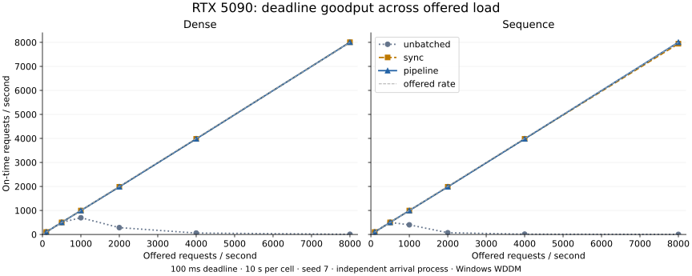
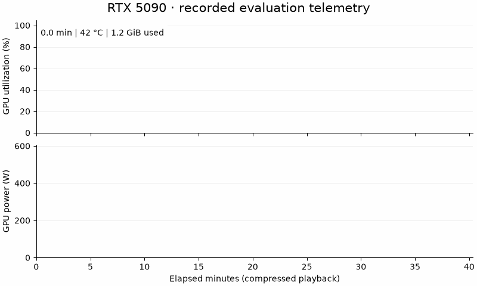
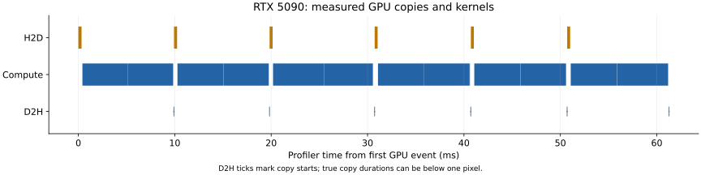
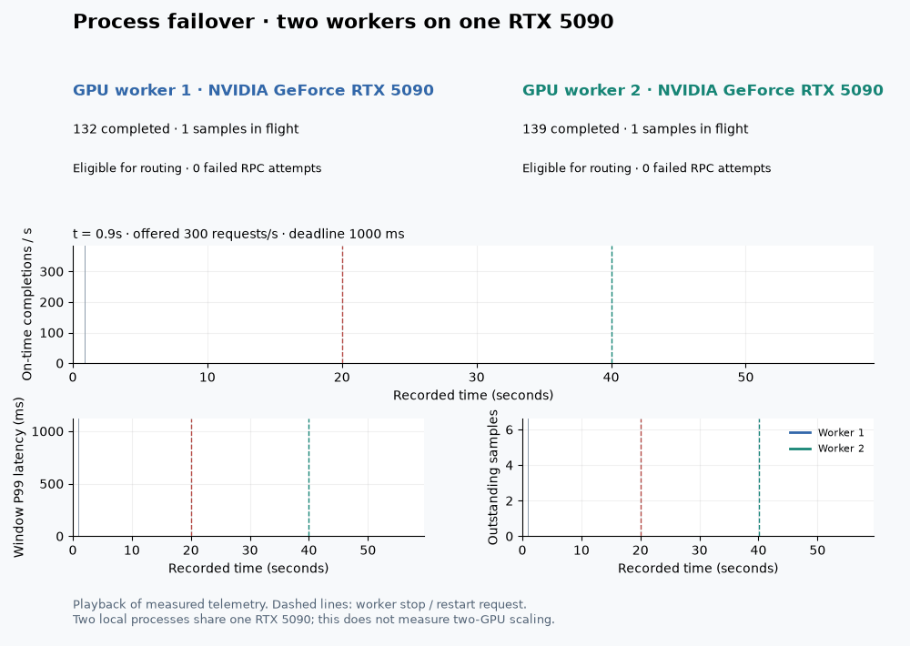

# RTX 5090 workstation evaluation — 2026-10-27

Two-slot batching completed all 18,000 requests in the three-seed steady/burst comparison within 100 ms. Both five-minute soaks completed all 300,291 offered requests on time. The larger matrix contains **91 extended workload cells** and **2,124,020 offered requests**, with sampled output comparisons and exact terminal accounting passing in every cell.



## Environment and validation

- One NVIDIA GeForce RTX 5090, 32 GB class, Windows 11 Enterprise build 26200, WDDM, driver 591.86; Intel Core Ultra 9 285K (24 cores), 64 GB class RAM. PyTorch 2.12.1+cu130, Python 3.12.14, one PyTorch CPU thread. No overclock or driver power-limit changes.
- **31 tests passed, 1 skipped**, including all three CUDA cases and a new cross-thread restart regression test. The skip is the Unix SIGTERM process-drain test: Windows terminates the process without invoking its Python signal handler. The installed wheel was tested with the source PYTHONPATH removed.
- A wheel was built with the normal scikit-build/CMake backend and installed successfully using project-local Zig 0.13.0 as the C++20 compiler. MSVC was unavailable. The direct extension fallback is reproducible with `scripts/build_windows_zig.py`.
- Timing uses monotonic, high-resolution `perf_counter` (QueryPerformanceCounter on this Python build). Its `monotonic()` clock used GetTickCount64 with 15.625 ms resolution, unsuitable for these latency measurements. POSIX memory telemetry gained a native Windows working-set implementation; MSVC warning flags are selected separately from GCC/Clang flags.
- FP32 model/input/output contract; `float32_matmul_precision=highest`, TF32 disabled. Precision and clock metadata accompany later cells. No reduced-precision speedup is claimed.
- Runtime baseline: `2874673`, with the Windows portability/timing changes included in this repository. Raw configurations, environment, source reference and SHA-256 checks accompany the results.

## Three-seed steady and burst comparison

1,500 requests per model/mode/seed; seeds 7, 17 and 27; nominal 1,000 requests/s; 100 ms deadline. Counts are summed; P99 and generator lag are medians of per-run summaries. These original shared-process runs include host scheduling effects. The independent-process matrix below separates arrival generation.

| Traffic / model | Mode | On time / 4,500 | Median P99 (ms) | Median generator lag P99 (ms) |
|---|---|---:|---:|---:|
| burst / dense | pipeline | 4,500 | 7.02 | 0.84 |
| burst / dense | sync | 4,500 | 72.06 | 58.83 |
| burst / dense | unbatched | 2,963 | 101.79 | 0.80 |
| burst / sequence | pipeline | 4,500 | 20.17 | 2.36 |
| burst / sequence | sync | 4,500 | 72.08 | 60.40 |
| burst / sequence | unbatched | 2,413 | 103.11 | 1.26 |
| steady / dense | pipeline | 4,500 | 5.84 | 0.73 |
| steady / dense | sync | 4,500 | 53.45 | 39.49 |
| steady / dense | unbatched | 4,500 | 9.16 | 0.74 |
| steady / sequence | pipeline | 4,500 | 11.50 | 0.84 |
| steady / sequence | sync | 4,500 | 53.68 | 37.76 |
| steady / sequence | unbatched | 4,469 | 65.34 | 0.81 |

Two slots improved observed latency in these runs, but the one-slot shared-process generator stalled more. These results therefore do not isolate physical CUDA overlap or a general hardware speedup.

## Independent-process sweeps

The dense (40 cells) and sequence (39 cells) matrices cover 100–8,000 requests/s, three execution modes, batch limits 8/16/32/64, one/two/four slots, model/sample sizes, four sequence-length distributions with and without buckets, and a 300 s soak per model. Load/model/length cells and batch/slot cells use 10 s windows, seed 7. These cells are exploratory, not repeated confidence estimates.

At the highest tested nominal rate, both pipeline models completed 80,063 / 80,063 requests in 10 s (8,006.3 req/s). Dense/sequence P99 were 17.01/45.09 ms. This establishes behavior at the tested load, not maximum sustainable throughput. Under unbatched overload, on-time goodput collapsed while requests expired; those negative outcomes remain in the data.

Latency histograms include terminal outcomes of accepted requests; immediate admission rejections, stale arrivals and transport expirations are counted separately. Histogram quantiles round upward to approximately 1%-width bins. Goodput is on-time offered-cohort completions divided by the configured arrival window; drain is separate. [All per-cell values](../results/rtx5090/summary.csv).

### Five-minute soaks

| Model | On time / offered | P99 (ms) | Generator lag P99 (ms) | RSS start → end (MiB) | Final-minute RSS range (MiB) |
|---|---:|---:|---:|---:|---:|
| dense | 300,291 / 300,291 | 6.61 | 0.74 | 848.8 → 865.9 | 865.2–865.9 |
| sequence | 300,291 / 300,291 | 39.23 | 13.94 | 1231.1 → 1247.7 | 1246.7–1247.7 |

All runtime reservations were zero after drain. RSS grew during the runs, including bounded timeline/allocator accumulation; a five-minute plateau is not a proof of absence of every leak. CUDA allocator observations and RSS histories remain in the raw files.

### Padding ablations

Buckets reduced padding but did not uniformly reduce latency. For short sequences, bucketed/unbucketed P99 were 16.18/7.52 ms. For mixed lengths they were 10.44/14.50 ms. These are single-seed application measurements; generator lag and batch fragmentation also differ. Preserve the bimodal/long cases rather than selecting only a favorable distribution.

## Large-model saturation

Each cell offers 1,000 requests/s for 15 s, 100 ms deadline, three seeds. The second model has approximately 2.15 billion parameters (about 8 GiB of FP32 weights). Maximum batch equals 128 samples for that model, so one request already fills an execution batch; its comparison measures in-flight execution behavior rather than combining multiple requests.

| Shape (features / hidden / samples per request) | Mode | Median goodput (req/s) | On time / offered, 3 seeds | Median accepted-request P99 (ms) |
|---|---|---:|---:|---:|
| 16,384 / 8,192 / 64 | sync | 517.07 | 24,275 / 45,077 | 90.49 |
| 16,384 / 8,192 / 64 | pipeline | 521.53 | 22,751 / 45,077 | 98.97 |
| 32,768 / 32,768 / 128 | sync | 45.67 | 1,752 / 45,077 | 118.38 |
| 32,768 / 32,768 / 128 | pipeline | 86.20 | 3,901 / 45,077 | 95.11 |

The 2.15B pipeline median corresponds to 11,034 on-time samples/s. Excess arrivals were predominantly rejected by bounded admission. One-slot execution also experienced execution/queue expirations. Offered load deliberately exceeds capacity, so goodput here is not a calibrated maximum sustainable capacity. Do not compare these request rates directly with single-sample small-model rates.

Observed nvidia-smi peaks over the recorded evaluation: **99% utilization**, **577.2 W**, **74°C**. Telemetry is sampled roughly once per second and includes normal workstation activity; it is not an isolated kernel efficiency measurement.



## Physical stream-overlap result

Both local profiler traces contain named CUDA kernels, distinct H2D/compute/D2H stream IDs and nonzero copy-byte metadata, unlike the earlier virtualized L40 trace. However, **copy/kernel intersections measured 0 µs in both traces**. The large trace contains 36 kernels and 12 copies. Three streams and higher application throughput do not establish physical overlap. This WDDM measurement is a negative overlap result; the runtime must not advertise verified transfer/compute overlap from it.



## Controlled process failure and recovery on one GPU

Two local HTTP worker processes shared the **same physical RTX 5090**. A separate-process generator offered 300 requests/s for 60 s with a 1,000 ms deadline. The router used 32 RPC threads, at most 16 active calls per replica, bounded pending work (256), binary HTTP over loopback and matching weight fingerprints. Worker 1 was terminated near 20 s and restarted near 40 s. This validates process/routing behavior; it does not measure two-GPU scaling or a physical GPU hardware fault.

The run offered 17,918 requests. Outcomes: `{"expired": 89, "ok": 17829}`; goodput 297.15 req/s. Failed RPC attempts per worker: [92, 0]. All emitted requests reached terminal outcomes; router active count returned to zero and sampled outputs matched. Failure/recovery can lose deadlines and retries may duplicate stateless computation.

The first recording exposed a recovery defect: different RPC threads retained old keep-alive sockets, and each stale socket could renew the worker-wide cooldown. Worker 1 did not resume completions before the recording ended. The fix invalidates cached connections across threads on a transport failure, discarding them lazily without closing sockets already used by in-flight calls. A regression test exercises two threads with independently stale sockets. The rerun shows worker 1 receiving work again after restart and ending outside cooldown.

Both recordings are retained. Before/after outcomes were `{"expired": 4, "ok": 17914}` / `{"expired": 89, "ok": 17829}`. The repaired run had more deadline expirations; successful rejoining is the demonstrated improvement, not an overall availability or throughput gain.



## Reproduction and remaining boundaries

```powershell
python -m pip install torch==2.12.1 --index-url https://download.pytorch.org/whl/cu130
python -m pip install pytest numpy scikit-build-core pybind11 ninja cmake ziglang==0.13.0 matplotlib pillow
python scripts/build_windows_zig.py
$env:PYTHONPATH="$PWD/src"
python -m pytest -q
python scripts/extended_matrix.py --device cuda --kind dense --output-dir results/rtx5090/dense --cell-seconds 10 --soak-seconds 300
python scripts/extended_matrix.py --device cuda --kind sequence --output-dir results/rtx5090/sequence --cell-seconds 10 --soak-seconds 300
python scripts/compute_saturation.py --output-dir results/rtx5090
```

The six medium-large runs use `benchmarks/extended.py --features 16384 --hidden 8192 --samples 64 --max-batch 256 --duration 15 --rps 1000 --deadline-ms 100`, modes sync/pipeline and seeds 7/17/27; use one slot for sync and two for pipeline. The baseline runs use `benchmarks/run.py --device cuda --requests 1500 --rps 1000 --deadline-ms 100`, the same seeds, with/without `--burst`.

Use `benchmarks/distributed.py` for matched one/two-worker load sweeps when two hosts are available, and `benchmarks/failover.py` with trusted operator argv files for controlled stop/restart. The distributed sweep driver also passed a CPU two-replica, one/two-worker smoke matrix. The renderer accepts a topology title/caption so a same-card recording is explicitly labeled.

Large JSON files are stored losslessly as `.json.gz`; decompress them before rerunning `benchmarks/summarize_5090.py --root results/rtx5090`. It validates accounting/output checks and rebuilds the plots. `benchmarks/animate_telemetry.py` recreates the GPU recording from its CSV. Checksums cover the actual published files; all earlier L40 data is retained.

**Still unverified:** real two-host/two-GPU scaling and failure experiments, physical copy/compute overlap, container/GPU Kubernetes deployment and Google Borg deployment. No cloud GPU was provisioned for this local run.
