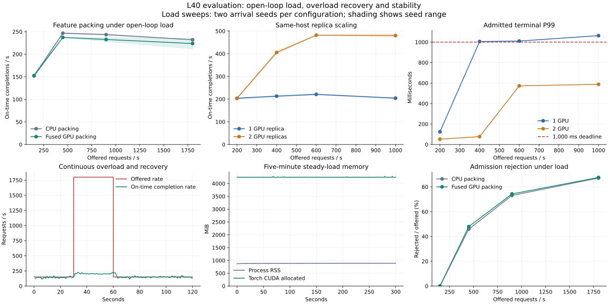

# L40 load, stress and scaling evaluation

On October 28, 2026, a dual-L40 host ran **61 load executions with 945,716 offered
requests**, totaling **1,800 seconds of arrival windows**. The study includes
46 packing-layout/seed configurations, sustained overload and recovery, a
five-minute steady-load run, batch-size ablations and matched one/two-GPU
replica sweeps. A low-load connection defect found in the first sweep was
reproduced, repaired and retested; both sweeps remain in the artifacts.

## Conditions and reproducibility

- Host: two Thunder L40 allocations, 12 configured vCPUs, 96 GiB memory.
  Recorded cgroup CPU quota is 11.88 CPU equivalents. CPU affinity is not pinned.
- Environment: Linux, Python 3.12, PyTorch 2.12.1+cu130, CUDA 13.0,
  driver 610.43.02, NVCC 13.0.88. Float32 matmul precision is `highest`, TF32
  matmul is disabled and autocast is not used.
- Feature workload: eight 128-column features, four shared per request;
  32 samples/request; `DenseModel(1024, 32768, 32)`, 1,108,410,400 parameters.
- Replica workload: `DenseModel(256, 32768, 32)`, 1,083,244,576 parameters;
  32 samples/request; CPU router and binary HTTP workers on the same host.
- Default maximum execution batch: 128 samples; two execution slots;
  2 ms batching delay; 1,000 ms end-to-end deadline; one PyTorch CPU thread
  per model worker. The models use seeded random weights.
- Main load cells: 20 seconds per rate/configuration, arrival seeds 7 and 17.
  Configuration order reverses on seed 17. Startup, model loading, compilation
  and warmup are excluded. Goodputs and quantiles below are medians of seed
  results; request counts aggregate both seeds.

The independent generator records its own scheduling lag and bounded-IPC drops.
The main load cells have no generator-stale or IPC-full drops. See the
[metric definitions](LOAD_TESTING.md),
[recorded environment](../results/stress-2026-10-28/results/environment.txt),
[exact commands](../results/stress-2026-10-28/results/stress/commands.json),
[supplemental commands](../results/stress-2026-10-28/results/supplement/commands.json)
and [repaired sweep commands](../results/stress-2026-10-28/results/repaired/commands.json).

Main measured source files match commit
[`d4f230f`](https://github.com/Zhang-Xin-Duke/gpu-inference-runtime/commit/d4f230f7b91cb1a69f440b1fec20985ca497f2a5).
The repaired sweep matches commit `f59e4a7`. Source hashes are recorded in each
sweep. The full GPU-host suite passes **44 tests** after repair; another run on
the second visible GPU passes all **8 feature-adapter tests**.

## One versus two GPU replicas

| Offered requests/s | One-GPU goodput | Two-GPU goodput | One-GPU P99 | Two-GPU P99 |
|---:|---:|---:|---:|---:|
| 200 | 203.80/s | 203.80/s | 124.4 ms | 52.1 ms |
| 400 | 213.05/s | 405.83/s | 1,005.5 ms | 76.8 ms |
| 600 | 220.98/s | 481.83/s | 1,010.5 ms | 573.1 ms |
| 1,000 | 204.25/s | 480.13/s | 1,063.1 ms | 587.8 ms |

At nominal 400 requests/s, both two-GPU seeds complete **16,233 / 16,233**
offered requests within the deadline. At nominal 1,000/s, the two-GPU result is
**2.35× deadline goodput**. The actual RPC pool increases from 16 to 32 threads
alongside GPU count, so this is deployment-level scaling. Deadlines and
rejection affect goodput; it is not a kernel-speedup ratio.

The highest-load cohort contains 40,212 offered requests in each configuration:

| Outcome, both seeds | One GPU | Two GPUs |
|---|---:|---:|
| On time | 8,170 | 19,205 |
| Admission rejected | 22,434 | 21,007 |
| Expired | 625 | 0 |
| Failed | 8,979 | 0 |
| Late completion | 4 | 0 |

P99 covers admitted terminal completions, including errors; immediate rejections
are counted separately. The overloaded single-worker router still records
deadline losses and unavailable-routing failures. The data does not establish
loss-free operation at arbitrary offered rates.

## Low-load defect discovered during scaling

In the initial two-GPU, 200/s sweep, **1,041 of 8,152** offered requests fail
across the two seeds. The workers themselves record no inference error or
admission rejection. Router observations show both workers entering cooldown.

A deterministic regression and a real HTTP-server regression reproduce a
specific failure path: the server closes an idle keep-alive connection, the
client reuses it and treats its disconnect as evidence that the entire worker
is unavailable. Cooling healthy workers can leave the router with no target.
The original sweep did not record exception classes, so the artifact alone
does not identify every individual failed socket operation.

The repair timestamps returned connections and retires idle sockets after four
seconds, ahead of the bundled server's five-second timeout. A reused socket
closed by its peer invalidates stale leases without cooling down the worker.
New-connection failures still cause cooldown. A single-worker router can
reconnect within the existing two-attempt and total-deadline budget.

The matched repaired sweep completes **8,152 / 8,152** low-load two-GPU requests
on time, with zero failed requests. In seed 7 it proactively retires three idle
connections per worker and records no attempt errors. This is a chronological
before/after retest, supported by deterministic regressions; both source
versions and raw sweeps are retained.

## Fused feature packing under actual model load

| Offered requests/s | CPU packing goodput | Fused packing goodput | CPU P99 | Fused P99 |
|---:|---:|---:|---:|---:|
| 150 | 152.32/s | 152.32/s | 53.7 ms | 63.9 ms |
| 450 | 246.53/s | 237.20/s | 548.0 ms | 581.7 ms |
| 900 | 243.38/s | 232.57/s | 564.6 ms | 614.6 ms |
| 1,800 | 232.00/s | 223.62/s | 620.7 ms | 642.7 ms |

The fused path does **not** improve full-model throughput in this compute-heavy,
128-sample-batch configuration. It introduces descriptor preparation, another
upload and GPU expansion work. In contrast, the separate packing matrix shows
benefits for wider/shared inputs: an eight-feature, 2,048-sample layout with
six shared features takes **6.656 ms → 3.028 ms**, or **2.20× packing speedup**.
The compact payload shrinks from 16 MiB to about 4.19 MiB plus descriptors.
Small layouts are faster with CPU packing. See [all packing conditions and
negative results](FEATURE_PACKING.md#measurement).

These results support retaining both packing backends and selecting one using
the actual feature layout and batch size. They do not support a blanket claim
that moving preparation to the GPU accelerates the whole service.

## Batch-size sensitivity and saturation knee

Supplemental runs keep the same GPU feature model and request limits, use the
same arrival seeds, and offer 450 → 900 → 450 requests/s for ten seconds per
phase. This isolates the configured batch ceiling within the fused path.

| Maximum samples/batch | Goodput at 900/s | P99 at 900/s |
|---:|---:|---:|
| 128 | 217.25/s | 645.8 ms |
| 256 | 260.75/s | 513.7 ms |
| 512 | 269.35/s | 498.6 ms |

Raising the ceiling from 128 to 512 yields about **24% more on-time throughput**
in that phase. This is a batching-configuration result, separate from kernel
speedup and replica scaling. The knee refinement at 225/300/375 requests/s also
shows CPU packing completing all 225/s arrivals in both seeds, while higher
rates require rejection. Ten-second phases and two seeds describe this trace;
they do not calibrate a long-run maximum capacity.

## Continuous overload and recovery

The same runtime sees 150/s for 30 seconds, 1,800/s for 30 seconds, then 150/s
for 60 seconds. The overloaded phase produces rejection rather than unbounded
queue growth. The recovery phase completes 8,916 requests with four rejections
for CPU packing, and 8,915 with five rejections for fused packing. No failed or
expired requests are recorded in these two runs. Cohorts are grouped by arrival
phase; the overview timeline instead plots completion time.

## Five-minute stability run

At nominal 150 requests/s, **45,295 / 45,295** requests finish within the deadline.
P99 is **63.25 ms**. Torch reserved CUDA memory remains **4,548,722,688 bytes**
throughout the sampled run. The median allocated CUDA memory changes by only
2 KiB between the first and last 60 observations. Process RSS medians are
881.64 MiB and 889.50 MiB; the peak is 889.64 MiB.

At drain, queued requests, active requests, request-byte reservations and staging
pool bytes all equal zero. Model weights and allocator-reserved memory have
separate lifetimes. The observed five-minute plateau is the stability evidence
for this run.

## Artifacts

- [Validated summary](../results/stress-2026-10-28/results/stress/summary.json)
- [Initial micro/load/recovery/soak data](../results/stress-2026-10-28/results/stress/)
- [Knee and batch-size ablations](../results/stress-2026-10-28/results/supplement/)
- [Repaired replica sweep and CUDA tests](../results/stress-2026-10-28/results/repaired/)
- [SHA-256 manifest](../results/stress-2026-10-28/results/stress/checksums.json)

Manifest paths are relative to the enclosing `results/` directory in the saved
run. Source revisions, command lines, generator diagnostics, failure outcomes,
GPU utilization/memory/power/clocks, thermal samples and CPU quotas are retained.
